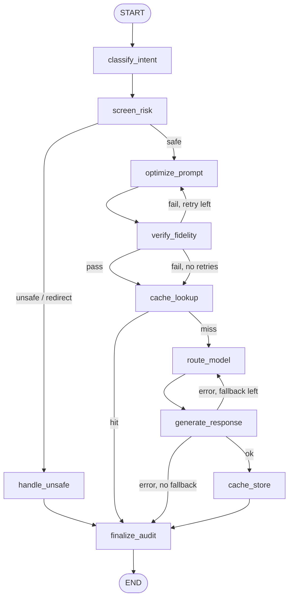

# Gateway Backend: LangGraph Framework

> **Status: scaffold built.** All 10 nodes exist and the full graph runs end to end. `optimize_prompt` and
> `verify_fidelity` are real; the other 8 are **stubs** that return plausible values so the graph works
> while each owner builds theirs. This document is the contract every node owner builds against.
> Change the README first, then the code.

**Quick start** (from the repo root, Python 3.12+):

```bash
pip install -r gateway/requirements.txt
python -m gateway.graph                       # run the UI's sample prompt and print the decision log
python -m gateway.graph "Is hail damage covered?"
python -m gateway.graph --json "..."          # full final state as JSON
python -m gateway.graph --diagram             # Mermaid diagram of the compiled graph
pytest gateway/tests                          # contract, path and optimizer tests
```

This folder will hold the backend of the Governed Prompt Gateway. Each step of the pipeline is a
**LangGraph node**, and each decision about where a query goes next is an **edge**. The existing UI in
`website/site/` stays as it is. It will call the graph through `website/server.py` instead of
computing results in the browser.

---

## 1. Core concepts

| Concept | What it is in our project | Rule |
|---|---|---|
| **State** | One `GatewayState` dictionary that carries a single query through the whole pipeline. | The schema in §4 is the only contract between teammates. |
| **Node** | One pipeline step: a plain Python function `def node(state) -> dict`. | Returns **only the fields it changed**. It never calls another node or imports another owner's code. |
| **Edge** | A connection between two nodes. | A **normal edge** always goes to the next node. A **conditional edge** reads a field from state and picks the next node. |
| **Router function** | The small function behind a conditional edge. | It only *reads* state and returns a branch name. It never computes or changes anything. The node makes the decision (e.g. writes `risk_label`) and the router just follows it. |
| **Decision log** | `state["decision_log"]`, a list that each node appends one entry to. | This is our audit trail and powers the UI's **Audit log** page. |
| **Config** | `gateway/config.yaml` holds every threshold, model list and price. | Thresholds are never hardcoded in a node or a router. |

Why it's set up this way: you can unit-test a node without LangGraph, swap it for a stub, or rewrite it,
and nothing else in the system changes as long as it reads and writes the fields listed in §4.

---

## 2. The graph

**10 nodes** in total (plus LangGraph's built-in `START` and `END`).



(If the fidelity check fails with no retries left, the optimized prompt is thrown away and the **original**
prompt continues to the cache. See §6.)

---

## 3. Nodes

| # | Node | UI page | Reads | Writes | Owner |
|---|---|---|---|---|---|
| 1 | `classify_intent` | Overview | `original_prompt` | `intent`, `intent_confidence`, `original_tokens` | _TBD_ |
| 2 | `screen_risk` | Risk screening | `original_prompt`, `intent` | `risk_label`, `risk_score`, `risk_categories` | Juee / Daniel (wraps `toxicity-detection-api/pipeline.py`) |
| 3 | `handle_unsafe` | Risk screening | `risk_label`, `risk_categories` | `response`, `final_status` | Juee / Daniel |
| 4 | `optimize_prompt` | Token optimizer | `original_prompt`, `optimizer_mode` | `optimized_prompt`, `optimized_tokens`, `techniques_applied`, `optimization_attempts` | **Riya Zingade** |
| 5 | `verify_fidelity` | Token optimizer | `original_prompt`, `optimized_prompt` | `fidelity_score`, `fidelity_passed`, `fidelity_checks`, `optimizer_mode`, `prompt_for_model`, `model_input_tokens` | **Riya Zingade** |
| 6 | `cache_lookup` | Semantic cache | `prompt_for_model` | `cache_hit`, `cache_similarity`, `response` (on hit) | Vanessa (wraps `toxicity-detection-api/cache.py`) |
| 7 | `route_model` | Model routing | `intent`, `risk_score`, `model_input_tokens`, `failed_models` | `model_id`, `model_tier`, `cost_estimate` | _TBD_ |
| 8 | `generate_response` | Overview | `prompt_for_model`, `model_id` | `response`, `output_tokens`, `generation_error`, `failed_models` | _TBD_ |
| 9 | `cache_store` | Semantic cache | `prompt_for_model`, `response` | _(writes to the cache store, not state)_ | Vanessa |
| 10 | `finalize_audit` | Audit log | everything | `final_status`, `total_cost`, `tokens_saved`, `latency_ms` | _TBD_ (integration owner) |

**Workstreams (6):** intent · risk/safety · token optimization · caching · model routing · response + integration.
One person can own more than one workstream, and a workstream can be shared. A workstream is a set of
related pipeline steps, not tied to one person.

### Node notes

- **`classify_intent`**: labels the customer-service intent (claims, billing, policy question, etc.).
  It also counts `original_tokens` so every later node has a baseline.
- **`screen_risk`**: runs the toxicity/jailbreak classifier (`notebooks/classification_jbb_finetune_v2_ran.ipynb`)
  on the **original** prompt. It always runs before optimization, because compressing first could hide or
  remove jailbreak wording, and there's no reason to optimize a prompt that's going to be blocked.
- **`handle_unsafe`**: a terminal branch. `unsafe` gets a policy refusal. `redirect` gets a safe handoff
  message (e.g. "routing you to a licensed agent"). The prompt never reaches a model.
- **`optimize_prompt`**: applies the optimizer techniques (whitespace, markup, filler, concise rewriting,
  dedup, plus the risky ones: context pruning and article dropping). In `safe` mode it skips the techniques
  marked `risk: true`.
- **`verify_fidelity`**: runs three checks, and all three must pass:
  1. **Similarity**: original vs optimized, at least `min_similarity`. The `lexical` backend (default, no
     dependencies) is cosine similarity over content words. `embedding` uses sentence-transformers.
  2. **Entity recall**: every number, amount, date, section or policy ID (anything containing a digit, e.g.
     `§4.2`, `$1,500`, `HO-12345`) must survive, up to `min_entity_recall`.
  3. **Question entities**: every entity in the user's actual question must survive.

  It sets `prompt_for_model`, the prompt every later node uses, and `model_input_tokens`.
  On the UI's sample prompt, full mode reaches −50% but context pruning drops the `Auto §9.4` line, so check 2
  fails. The retry in safe mode reaches −29% and passes.
- **`cache_lookup` / `cache_store`**: embedding search over previously answered prompts. Lookup runs on
  `prompt_for_model`, because the normalized text gives more cache hits. Only successful, safe responses
  are stored. The cache runs **after** risk screening on purpose. In embedding space, "how do I protect my
  computer from hackers" sits close to "how do I hack into someone's computer", so a cache placed before
  screening could hand a cached safe answer to an unsafe prompt.
- **`route_model`**: picks the cheapest tier (Small / Medium / Large, using the model list in the UI) that
  meets the intent's complexity and risk requirements. It skips any model in `failed_models`.
- **`generate_response`**: calls the provider (Groq / OpenRouter / Google AI Studio), or returns a simulated
  response when `config.simulate: true`, so the demo works offline.
- **`finalize_audit`**: always the last node, no matter which path the query took. It computes the totals
  the dashboard shows and closes the decision log.

---

## 4. Shared state (the contract)

```python
from typing import Annotated, Literal, TypedDict
import operator

class GatewayState(TypedDict, total=False):
    # input (set by gateway.graph.run)
    query_id: str
    original_prompt: str
    started_at: float                    # time.perf_counter() when the run began

    # 1. classify_intent
    intent: str
    intent_confidence: float
    original_tokens: int

    # 2–3. screen_risk / handle_unsafe
    risk_label: Literal["safe", "unsafe", "redirect"]
    risk_score: float                    # 0 = safe, 1 = certainly unsafe
    risk_categories: list[str]

    # 4. optimize_prompt
    optimizer_mode: Literal["full", "safe"]
    optimized_prompt: str
    optimized_tokens: int
    techniques_applied: list[dict]       # [{"id", "name", "tokens_before", "tokens_after", "changes"}]
    optimization_attempts: int

    # 5. verify_fidelity
    fidelity_score: float
    fidelity_passed: bool
    fidelity_checks: dict                # each check's result, for the UI and the audit log
    prompt_for_model: str                # optimized_prompt if fidelity passed, else original_prompt
    model_input_tokens: int              # tokens in prompt_for_model

    # 6, 9. cache_lookup / cache_store
    cache_hit: bool
    cache_similarity: float

    # 7. route_model
    model_id: str
    model_tier: Literal["Small", "Medium", "Large"]
    cost_estimate: float
    failed_models: Annotated[list[str], operator.add]

    # 8. generate_response
    response: str
    output_tokens: int
    generation_error: str | None

    # 10. finalize_audit
    final_status: Literal["answered", "cached", "blocked", "redirected", "failed"]
    tokens_saved: int
    total_cost: float
    latency_ms: int

    # every node (append-only)
    decision_log: Annotated[list[dict], operator.add]
    errors: Annotated[list[dict], operator.add]
```

The source of truth is `gateway/state.py`, which also has the `WRITES` table (who may write each field).

`Annotated[..., operator.add]` tells LangGraph to **append** what a node returns to the list instead of
replacing the list. A node returns `{"decision_log": [entry]}` and the entry is added to the end.

### Decision log entry format

Every node appends exactly one entry:

```python
{
    "node": "screen_risk",
    "decision": "safe",                 # the outcome the next edge will act on
    "reason": "risk_score 0.07 < block threshold 0.80",
    "metrics": {"risk_score": 0.07},
    "duration_ms": 41,
}
```

### Changing the schema

You can add a field in a PR that updates this README too. Renaming or removing a field needs a
sign-off from every owner who reads it (see the "Reads" column in §3).

---

## 5. Edges

| From | Router reads | Condition (thresholds from `config.yaml`) | Goes to |
|---|---|---|---|
| `START` | | always | `classify_intent` |
| `classify_intent` | | always | `screen_risk` |
| `screen_risk` | `risk_label` | `safe` | `optimize_prompt` |
| | | `unsafe` or `redirect` | `handle_unsafe` |
| `handle_unsafe` | | always | `finalize_audit` |
| `optimize_prompt` | | always | `verify_fidelity` |
| `verify_fidelity` | `fidelity_passed`, `optimization_attempts` | passed | `cache_lookup` |
| | | failed and `optimization_attempts < optimizer.max_attempts` | `optimize_prompt` (retry in `safe` mode) |
| | | failed and no retries left | `cache_lookup` (with the original prompt) |
| `cache_lookup` | `cache_hit` | `True` | `finalize_audit` |
| | | `False` | `route_model` |
| `route_model` | | always | `generate_response` |
| `generate_response` | `generation_error`, `failed_models` | no error | `cache_store` |
| | | error and `len(failed_models) <= routing.max_model_fallbacks` | `route_model` (choose another model) |
| | | error and no fallbacks left | `finalize_audit` |
| `cache_store` | | always | `finalize_audit` |
| `finalize_audit` | | always | `END` |

The router functions are in `gateway/routers.py`. Each one returns the branch label shown above, and `graph.py` maps the label to a node.

How `screen_risk` sets `risk_label`:
`risk_score >= risk.block_threshold` → `unsafe`, `risk_score >= risk.redirect_threshold` → `redirect`, otherwise `safe`.

---

## 6. Fallbacks and failure handling

There are two kinds of fallback. **Planned branches** are part of the graph (the edges in §5).
**Crash handling** covers a node that raises an exception.

### Planned branches

| Situation | What happens |
|---|---|
| Optimized prompt changed the meaning | Retry once in `safe` mode (no context pruning / article dropping). If it still fails, send the **original** prompt. We give up the token savings rather than risk a wrong answer. |
| Risk classifier is unsure (score between the two thresholds) | `redirect`: the query goes to a human handoff, never to a model. |
| Model call fails (rate limit, timeout, provider down) | Add the model to `failed_models` and go back to `route_model`, which picks the next-cheapest model that qualifies (same tier first, then one tier up). With `max_model_fallbacks: 2`, a query gets 3 tries in total, then `final_status = "failed"` and the user gets a polite error message. |
| Cache hit | Skip routing and generation completely, at zero model cost. |

### Crash handling: fail closed for safety, fail open for savings

Every node is wrapped by the shared `safe_node` decorator (in `gateway/nodes/_base.py`). If the node raises
an exception, the decorator logs it to `errors` and `decision_log` and returns that node's **default
output** below, so a bug in one node never crashes the whole gateway.

| Node | If it crashes | Why |
|---|---|---|
| `classify_intent` | `intent = "unknown"` | Routing treats unknown intent as needing at least the Medium tier. |
| `screen_risk` | `risk_label = "redirect"` | **Fail closed.** We never let a prompt through because a safety check broke. |
| `handle_unsafe` | generic refusal message | |
| `optimize_prompt` | `optimized_prompt = original_prompt` | **Fail open.** We lose the savings but the answer is unaffected. |
| `verify_fidelity` | `fidelity_passed = False` → use the original prompt | If we can't confirm the meaning survived, we don't trust the compression. |
| `cache_lookup` | `cache_hit = False` | A cache problem only costs money. |
| `route_model` | `config.routing.default_model` | |
| `generate_response` | `generation_error` set → model fallback branch | |
| `cache_store` | skip (logged) | |
| `finalize_audit` | minimal summary with `final_status` | |

---

## 7. Folder layout

```
gateway/
├── README.md              ← this file
├── requirements.txt       ← langgraph, pyyaml, pytest (+ optional extras)
├── config.yaml            ← thresholds, model list, prices, simulate flag; one section per owner
├── settings.py            ← loads config.yaml; settings.override(...) for tests
├── state.py               ← GatewayState (§4) + WRITES ownership table
├── tokens.py              ← shared token counter (estimate | spacy | hf:<repo>)
├── graph.py               ← the only file that imports LangGraph; also the CLI
├── routers.py             ← the conditional-edge functions from §5
├── nodes/
│   ├── __init__.py        ← NODES: name → function, in pipeline order
│   ├── _base.py           ← safe_node decorator, decision() log helper
│   ├── intent.py          ← classify_intent                      STUB
│   ├── risk.py            ← screen_risk (STUB), handle_unsafe
│   ├── optimizer.py       ← optimize_prompt, verify_fidelity      REAL
│   ├── cache.py           ← cache_lookup, cache_store             STUB (exact match)
│   ├── routing.py         ← route_model                           STUB (default model + fallback order)
│   ├── generate.py        ← generate_response                     SIMULATED
│   └── audit.py           ← finalize_audit                        REAL
└── tests/
    ├── test_contract.py   ← every node (and its crash fallback) only writes fields it owns
    ├── test_graph_paths.py← every branch in §5 runs end to end, including crash handling
    └── test_optimizer.py  ← technique and fidelity unit tests
```

Every stub returns fixed, plausible values, so the full graph runs end to end today. Each stub's docstring
says what the real version needs to do. To replace a stub:

1. Keep the function name, the `@safe_node(...)` decorator and the returned field names.
2. Replace the body, and return exactly one `decision(...)` in `decision_log`.
3. Put any thresholds or model names in your section of `config.yaml`.
4. Load big models lazily (on first call, e.g. with `functools.lru_cache`), never at import time.
5. `pytest gateway/tests` must still pass. The contract tests will tell you if you wrote a field you don't own.

### Connecting to the UI

`website/server.py` gets one new endpoint:

```
POST /api/gateway/run   {"prompt": "..."}   ->   the final GatewayState as JSON
```

Each UI page reads its fields from that response (Risk screening ← `risk_*`, Token optimizer ←
`optimized_*` / `techniques_applied` / `fidelity_*`, Semantic cache ← `cache_*`, Model routing ←
`model_*` / `cost_estimate`, Audit log ← `decision_log`). The page layout and styles stay the same.

---

## 8. Team workflow

1. Approve this README. It's the contract.
2. Scaffold: `state.py`, `graph.py`, `routers.py`, `config.yaml`, all 10 stub nodes, and the contract tests.
3. Each owner works on a branch off `langraph_setup` named `node/<workstream>` (e.g. `node/optimizer`) and
   only edits their own `nodes/<file>.py`, their tests and their section of `config.yaml`.
4. A PR merges only when `pytest gateway/tests` passes, which includes the contract and path tests.
5. Run the full graph locally with `python -m gateway.graph "your prompt here"`, which prints the
   decision log, the prompt sent to the model and the response.
6. `python -m gateway.graph --diagram` regenerates the Mermaid diagram for slides and documentation.

---

## 9. Open questions (decide before scaffolding)

- [ ] **Owners:** fill in names for the _TBD_ rows in §3.
- [ ] **Cache position:** the cache currently runs *after* optimization (same order as the UI). The
      alternative is running it before, which skips optimization on a cache hit. Optimization is cheap,
      so keeping the UI order seems fine.
- [ ] **Browser-side optimizer:** right now `app.js` runs the optimizer live in the browser. Do we keep
      that as an instant preview and treat the backend as the source of truth, or move it entirely
      to the backend?
- [ ] **Starting thresholds** (in `config.yaml`, placeholders to tune on the datasets): `risk.block_threshold`
      0.80, `risk.redirect_threshold` 0.50, `optimizer.fidelity.min_similarity` 0.80 (lexical),
      `optimizer.fidelity.min_entity_recall` 1.0, `cache.min_similarity` 0.90 (Vanessa's value),
      `optimizer.max_attempts` 2, `routing.max_model_fallbacks` 2.
- [ ] **Python version:** `toxicity-detection-api` pins `scikit-learn==1.6.1`, which needs Python 3.12.
      The gateway itself runs on 3.12–3.14. Once the real risk node is wired in, everyone should use 3.12.
- [ ] **Known gap in the fidelity check:** it doesn't yet catch a dropped negation ("I did **not**
      authorize this"). The current techniques never remove "not"/"never" on their own, but a future
      technique could. A negation check is the next improvement for `verify_fidelity`.
